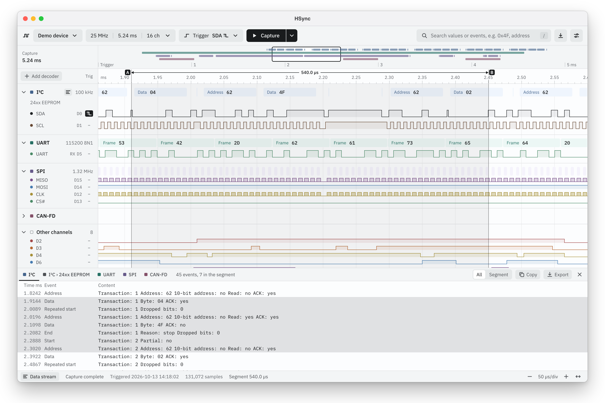
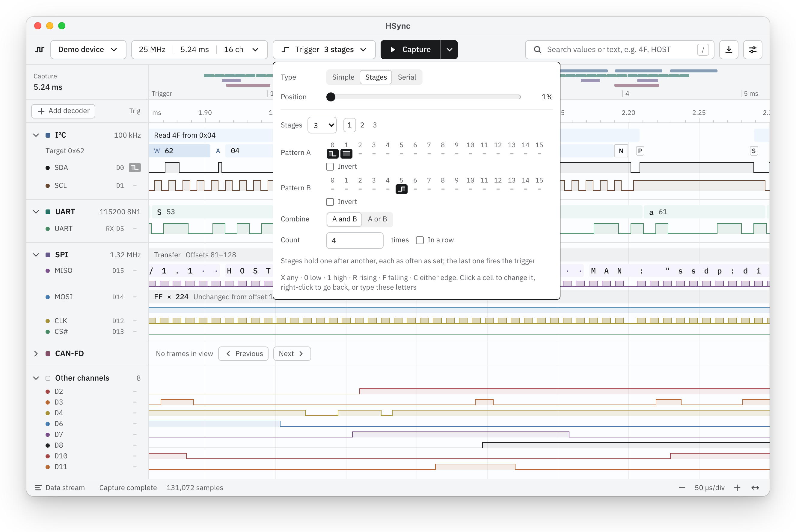
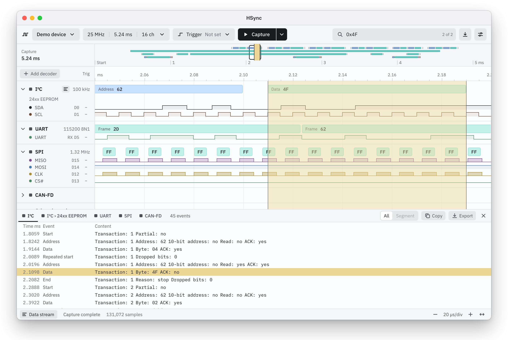
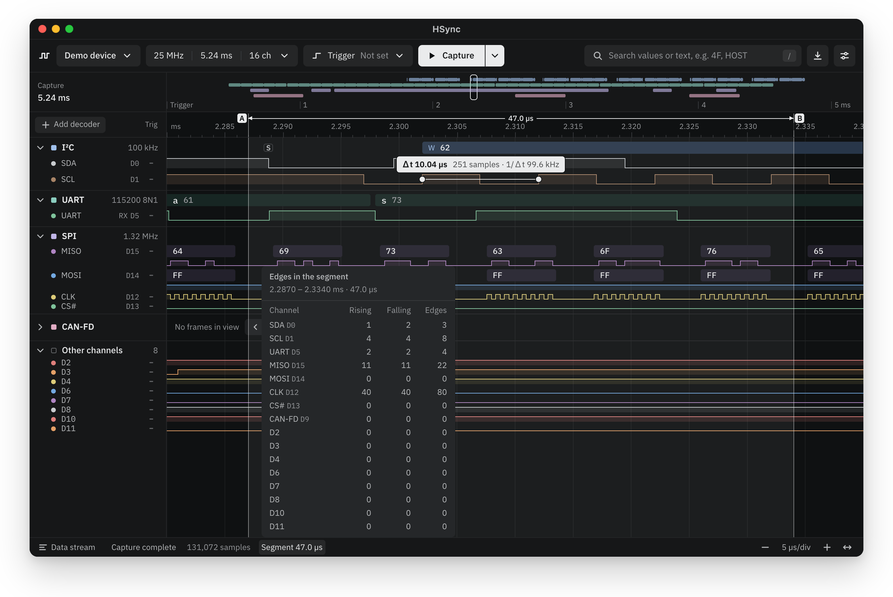

<div align="center">


# HSync

**A modern, general-purpose logic analyzer app**

Capture, trigger, decode and measure, with one app for logic analyzers from several makers.

[](https://github.com/HalfSweet/HSync/releases/latest)
[](https://github.com/HalfSweet/HSync/releases)
[](#download)
[](#license)

**English** · [简体中文](README.zh-CN.md)

[Download](#download) · [Getting started](#getting-started) · [User guide](docs/user-guide.md) · [Report a problem](https://github.com/HalfSweet/HSync/issues/new)

</div>

<br>

<picture>
  <source media="(prefers-color-scheme: dark)" srcset="assets/screenshots/en-US/hero-dark.webp">
  
</picture>

HSync is a desktop app for logic analyzers that isn't tied to any one maker. It drives DreamSourceLab's DSLogic, ALIENTEK's ATK-Logic and PXLogic's PX-Logic analyzers, with experimental support for Sipeed's SLogic16U3 ([full list](#supported-devices)), and gives them all the same tools. Plug one in and press **Capture**: decoded I²C, UART, SPI and CAN traffic appears right above the waveforms it came from, while the capture is still running, and dozens of protocol decoders are a search away. HSync saves captures in its own `.hsync` format, opens and exports DSView's `.dsl` files and imports VCD, FST and GHW waveforms, so your captures come along, and everything it needs is in the package: the device firmware and the decoders.

No hardware at hand? HSync opens its built-in **Demo device**, which plays back a recording of four buses, so you can try everything straight away.

## Features

### Capture

- **Logic analyzers from several makers**: every DreamSourceLab DSLogic, ALIENTEK's ATK-Logic DL16 and DL16 Plus, PXLogic's PX-Logic 32, 16 Pro, 16 Plus and 16 Base, and experimental Sipeed SLogic16U3 support ([full list](#supported-devices)). HSync drives each one the way its maker's own app does, and loads the firmware and FPGA bitstreams they need by itself.
- **Buffer and Stream modes**, with RLE compression for captures longer than the device's memory where the device has it, and a warning when a capture would need more than half of your computer's memory.
- **Single, Repeat, Loop and Instant capture.** Repeat keeps the last complete capture on screen while the next one records in the background; Loop keeps capturing and holds on to the most recent stretch.
- **Device options** for the threshold voltage, glitch filter, external clock, external trigger input and more, remembered for next time.
- **Hot-plug aware.** Plug in a logic analyzer while the demo is open and HSync offers to switch to it; if the USB connection drops for a moment, HSync reopens the device with its settings.

### Trigger

- **Triggers on the channel rows.** Click the trigger slot to the right of a channel's name and pick a rising, falling or any edge, or a high or low level.
- **Stage triggers** with up to 16 stages, each combining two patterns that must hold a set number of times, and **serial triggers** on a data value of up to 16 bits (on a DSLogic in Buffer mode).
- **Adjustable trigger position**, with the ruler counting time from the trigger.



### Decode

- **I²C, UART, SPI and CAN decoders**, drawn in line with the waveforms. They show what the bus carried, event by event, without guessing what it meant.
- **Dozens of protocols** from HSync's own decode engine, [uiharu](uiharu/): buses, debug and trace links, flash and SD cards, RTCs, sensors, converters, displays and radio interfaces. Compatible layers form chains, such as UART → Modbus RTU → Modbus PDU or JTAG → JTAG-DP → MEM-AP. The [coverage record](docs/decoder-coverage.md) lists supported device profiles and remaining differences from DSView and sigrok.
- **Deeper protocol interpretation** includes cJTAG OScan0/1, SWD debug and memory-access observations, 1-Wire memory/PIO devices, CFP management, MIDI names, DMX timing and version-specific LIN checksums.
- **Decoding keeps up with the capture**: results appear while the device is still filling it, and decoders can be added or changed meanwhile.
- **Decoders of your own**, written in HSync's TypeScript decoder language with their names in any language, loaded from Settings without rebuilding the app and carried along in the captures that use them; one named like a built-in decoder stands in for it.
- **Values in hex, decimal, octal, binary or ASCII**, chosen per decoder.
- **The data stream** beside the waveforms, or in a window of its own on another screen, lists everything a decoder found. Click a row to jump to it on the waveform and read all of its fields; copy the list or export it as CSV or text.



### Measure and search

- **An overview of the whole capture**, with each decoder's activity, to see where things happen and get there in one click.
- **Hover a pulse** to read its width, plus the period, frequency and duty cycle it makes with the next pulse.
- **Click two edges** to measure the time between them, on one channel or across channels; the pointer snaps to edges.
- **Mark a segment** on the ruler to see its duration and every channel's rising and falling edges inside it.
- **Search** decoded data for values, byte sequences or event kinds (`0x4F 0x32`, `address`), or find a level pattern such as `D3=R D5=1`.



### Files

- **Saves captures as `.hsync` files** with their decoders, channel names, colours and view, and **opens DSView `.dsl` captures** of every version. Supported decoder settings are translated; unsupported settings remain saved with import notes. Exported `.dsl` files open in DSView, with channel names.
- **Imports VCD, FST and GHW waveforms** from simulators and FPGA logic analyzers (Vivado ILA, Signal Tap, …): pick the signals, and each bit becomes a channel on the clock the file was sampled with.
- **Exports DSView `.dsl`, CSV, VCD, FST, sigrok `.sr` and raw binary**: the whole capture or a segment, all channels or a few.
- **Sessions** keep your device settings, channels, triggers and decoders; DSView `.dsc` sessions load too.

### Interface

- **Light and Dark themes**, Comfortable and Compact density, and English or Simplified Chinese.
- **Waveforms drawn with WebGPU** where it is available, with Canvas2D as the fallback.
- **Keyboard shortcuts** for zooming, panning, searching, opening, saving and more, all of which you can change.
- **Updates inside the app**: HSync checks at startup and installs a new version in one click.

## Download

Get the latest version from the [Releases page](https://github.com/HalfSweet/HSync/releases/latest).

| Platform | Package                             | Requirements                     |
| -------- | ----------------------------------- | -------------------------------- |
| macOS    | `.dmg` (Apple silicon and Intel)    | macOS 13.3 or later              |
| Windows  | `-setup.exe` (x64)                  | Windows 10 or 11                 |
| Linux    | `.AppImage`, `.deb` or `.rpm` (x64) | Ubuntu 22.04, Debian 12 or newer |

The firmware and the protocol decoders are included; you don't need any maker's app. On another platform, you can [build HSync from source](#building-from-source).

### First launch

- **macOS**: HSync isn't notarized by Apple yet, so the first time you open it, macOS says it can't verify the app. Close the message, open **System Settings → Privacy & Security** and click **Open Anyway** next to the note about HSync. You only need to do this once.
- **Windows**: the installer isn't code-signed yet, so SmartScreen may stop it: click **More info → Run anyway**. HSync reaches logic analyzers through the WinUSB driver; if it says no usable USB driver is available, install WinUSB for the device with [Zadig](https://zadig.akeo.ie/) (**Options → List All Devices**, select the device, choose **WinUSB** and click **Install Driver** or **Replace Driver**).
- **Linux**: to use a logic analyzer without root, add the udev rule for its maker, then plug the device in again. DSView and PXView install rules of their own, so you can skip the ones they cover.

  ```sh
  # DreamSourceLab DSLogic
  sudo tee /etc/udev/rules.d/60-dreamsourcelab.rules > /dev/null <<'EOF'
  SUBSYSTEM=="usb", ATTRS{idVendor}=="2a0e", MODE="0666"
  EOF
  # ALIENTEK ATK-Logic
  sudo tee /etc/udev/rules.d/60-atk-logic.rules > /dev/null <<'EOF'
  SUBSYSTEM=="usb", ATTRS{idVendor}=="1a86", ATTRS{idProduct}=="ffcc", MODE="0666"
  EOF
  # PXLogic PX-Logic
  sudo tee /etc/udev/rules.d/60-pxlogic.rules > /dev/null <<'EOF'
  SUBSYSTEM=="usb", ATTRS{idVendor}=="1a86", ATTRS{idProduct}=="5237", MODE="0666"
  SUBSYSTEM=="usb", ATTRS{idVendor}=="16c0", ATTRS{idProduct}=="05dc", ATTRS{manufacturer}=="PX*", MODE="0666"
  EOF
  # Sipeed SLogic16U3
  sudo tee /etc/udev/rules.d/60-sipeed-slogic.rules > /dev/null <<'EOF'
  SUBSYSTEM=="usb", ATTRS{idVendor}=="359f", ATTRS{idProduct}=="3031", MODE="0666"
  EOF
  sudo udevadm control --reload-rules
  sudo udevadm trigger
  ```

### Updates

HSync looks for a new version each time it starts (turn this off under **Settings → Behaviour**). When one is out, a dot appears on the settings button: open **Settings → About** and click **Download and restart**.

## Getting started

1. **Open a device.** Connect your logic analyzer and choose it from the device menu at the top left. Some devices take a few seconds to open the first time, while HSync loads their firmware. Without hardware, you're on the **Demo device**.
2. **Set up the capture.** The button next to the device menu shows the sample rate, duration and channel count; click it to change them and the device's options: the operation mode (Buffer or Stream), the threshold and whatever else the device offers, such as a glitch filter or an external clock.
3. **Set a trigger** (optional). Click the trigger slot to the right of a channel's name and pick an edge or a level. **Trigger** in the top bar has the trigger position, stage triggers and serial triggers.
4. **Capture.** Press **Capture**. The arrow beside it switches between **Single**, **Repeat** and **Loop**, or starts an **Instant** capture that ignores the trigger.
5. **Decode.** Click **Add decoder**, search for a protocol and choose its channels. Open the **Data stream** from the button at the right of the top bar to list everything it decoded.
6. **Look closer.** Ctrl/⌘ + wheel zooms, dragging pans and `Home` shows the whole capture. Hover a pulse to read it, click two edges to measure between them and press `/` to search.
7. **Save.** ⌘S / Ctrl+S saves an `.hsync` file with the decoders, colours and view; **Export…** in the export menu writes DSView `.dsl`, CSV, VCD, FST, sigrok and binary files.

The [user guide](docs/user-guide.md) covers every feature and keyboard shortcut.

## Supported devices

| Maker          | Device                    | Channels | USB      |
| -------------- | ------------------------- | -------- | -------- |
| DreamSourceLab | DSLogic                   | 16       | 2.0      |
| DreamSourceLab | DSLogic Pro               | 16       | 2.0      |
| DreamSourceLab | DSLogic Plus              | 16       | 2.0      |
| DreamSourceLab | DSLogic Basic             | 16       | 2.0      |
| DreamSourceLab | DSLogic U2Basic           | 16       | 2.0      |
| DreamSourceLab | DSLogic U2Pro16           | 16       | 2.0      |
| DreamSourceLab | DSLogic U3Pro16           | 16       | 3.0      |
| DreamSourceLab | DSLogic U3Pro32           | 32       | 3.0      |
| ALIENTEK       | ATK-Logic DL16            | 16       | 2.0      |
| ALIENTEK       | ATK-Logic DL16 Plus       | 16       | 2.0      |
| PXLogic        | PX-Logic 32               | 32       | 3.0      |
| PXLogic        | PX-Logic 16 Pro           | 16       | 3.0      |
| PXLogic        | PX-Logic 16 Plus          | 16       | 3.0      |
| PXLogic        | PX-Logic 16 Base          | 16       | 3.0      |
| Sipeed         | SLogic16U3 (experimental) | 16       | 3.0      |
| —              | Demo device               | 16       | built in |

HSync talks to each device the way its maker's app does, byte for byte: to DSLogic devices like DSView, to ATK-Logic devices like ALIENTEK's ATK-Logic app and to PX-Logic devices like PXView. It has been tested on a DSLogic U2Pro16; if you use another model, please [let us know how it went](https://github.com/HalfSweet/HSync/issues/new). DSCope oscilloscopes, DSView's oscilloscope and data acquisition modes, the PWM outputs of ATK-Logic devices, and the trigger and PWM outputs of PX-Logic devices aren't supported yet. To update the firmware of an ATK-Logic device, use ALIENTEK's ATK-Logic app. When HSync opens a PX-Logic device that runs another firmware version, it first writes the firmware of PXView 1.6.5 into the device, as PXView does with its own.

The SLogic16U3 port follows [Sipeed's official libsigrok driver](https://github.com/sipeed/libsigrok/tree/slogic-dev/src/hardware/sipeed-slogic-analyzer) using Rust and nusb. It supports Stream capture, simple software triggers, Loop capture and a 0–6 V threshold. With USB 3.0, the maximum advertised sample rate is 200 MHz across 16 channels, 400 MHz when only D0–D7 are used, or 800 MHz when only D0–D3 are used; USB 2.0 limits those rates to 20, 40 and 80 MHz. It uses the device's installed firmware and does not flash it. This experimental port has passed mock tests and real USB 3.0 smoke tests: three consecutive 65,536-sample captures at 5 MHz in each of the 4-, 8- and 16-channel modes, plus short captures configured at their 800, 400 and 200 MHz limits. Channel mapping, signal timing, sustained high-rate throughput and USB 2.0 still need hardware validation. Other SLogic models and bootloader mode are not supported. See the [connection and capture notes](docs/user-guide.md#sipeed-slogic16u3).

## Questions

**Do I need my logic analyzer's own app?**
No. HSync brings its own firmware and decoders. You can keep DSView or another maker's app installed alongside it, and HSync opens DSView's captures and sessions.

**Can I take a capture to other tools?**
Yes: export it as a DSView capture for DSView, as a sigrok session for PulseView, as VCD or FST for GTKWave, Surfer and other waveform viewers, or as CSV for spreadsheets and scripts. The other way round, **Open file…** imports the VCD, FST and GHW waveforms those tools and FPGA logic analyzers write.

**Where are the logs?**
Open **Settings**, and under **Diagnostics** click **Show in folder**. Attach the latest log when you [report a problem](https://github.com/HalfSweet/HSync/issues/new).

## Building from source

You need:

- [Node.js](https://nodejs.org/) 22.12 or later and [pnpm](https://pnpm.io/) 12
- [Rust](https://rustup.rs/) (stable)
- [Tauri's system dependencies](https://tauri.app/start/prerequisites/) for your platform

Decoder TypeScript sources are tracked; generated IR and Rust are disposable local output. Run `pnpm dsl:generate` before direct workspace Cargo commands. `pnpm tauri dev`, `pnpm tauri build` and `pnpm bundle` generate automatically; `pnpm test` prepares only IR. See the [DSL workflow](uiharu/docs/dsl.md) for setup and checks.
