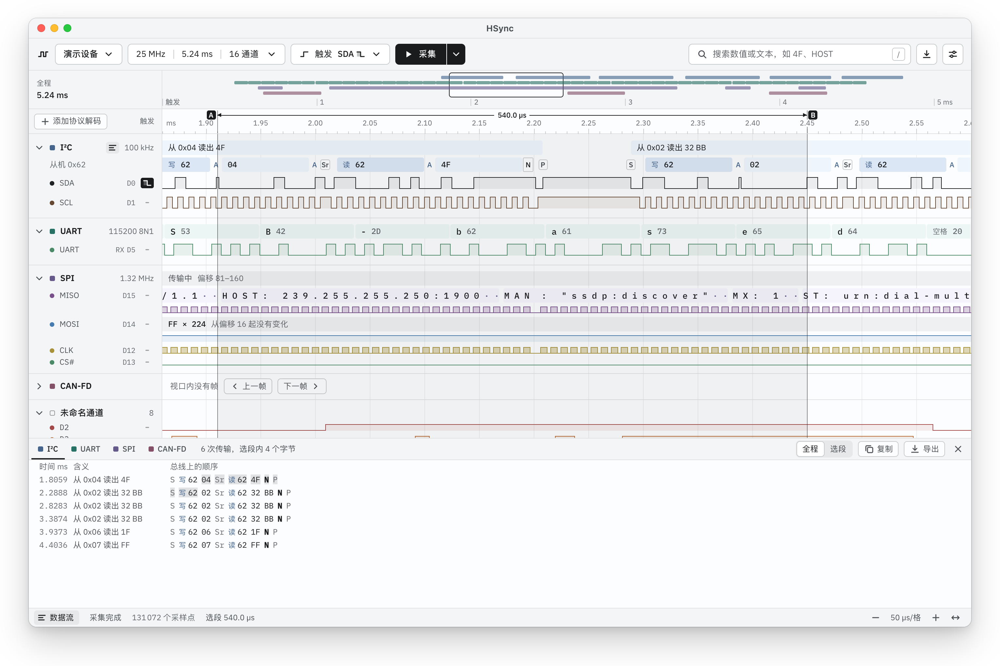
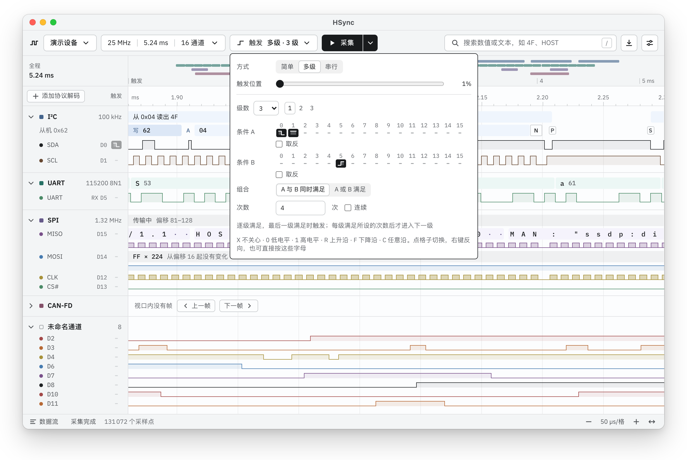
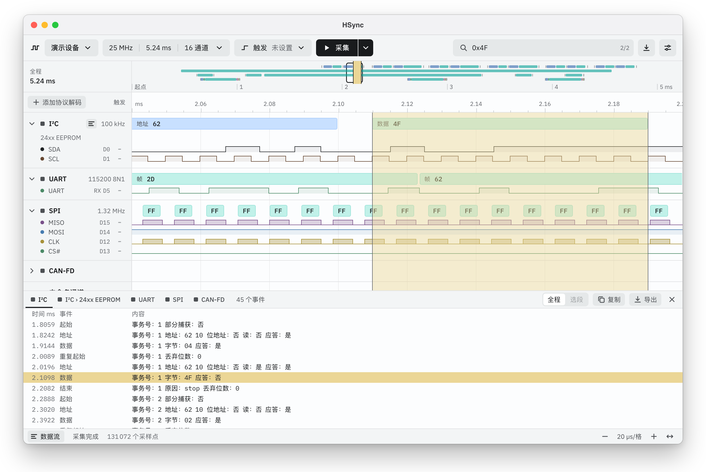
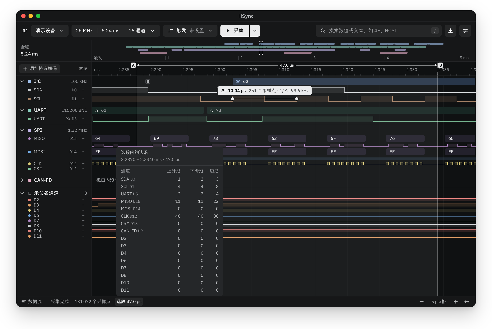

<div align="center">


# HSync

**为 DreamSourceLab DSLogic 打造的现代逻辑分析仪上位机**

采集、触发、解码、测量，DSView 的文件照常打开。

[](https://github.com/HalfSweet/HSync/releases/latest)
[](https://github.com/HalfSweet/HSync/releases)
[](#下载)
[](LICENSE)

[English](README.md) · **简体中文**

[下载](#下载) · [快速上手](#快速上手) · [用户指南（英文）](docs/user-guide.md) · [反馈问题](https://github.com/HalfSweet/HSync/issues/new)

</div>

<br>

<picture>
  <source media="(prefers-color-scheme: dark)" srcset="assets/screenshots/zh-CN/hero-dark.webp">
  
</picture>

HSync 是 DreamSourceLab DSLogic 系列逻辑分析仪的桌面上位机。接上 DSLogic，按下「采集」：I²C、UART、SPI 与 CAN 的解码结果就显示在对应波形的正上方，DSView 自带的 150 种协议解码器也是搜索即用。HSync 能打开、保存 DSView 的 `.dsl` 文件，以前的采集照常可用；运行所需的一切都已打包在内：设备固件、解码器，以及解码器依赖的 Python 运行环境。

手边没有硬件？HSync 会打开内置的「演示设备」，回放一段包含四种总线的采集数据，所有功能都可以马上试用。

## 功能

### 采集

- **支持全部 DSLogic 型号**，从初代 DSLogic 到 U3Pro32（[完整列表](#支持的设备)）。固件与 FPGA 位流已内置，打开设备时自动加载。
- **Buffer 与 Stream 两种模式**：时长超出设备内存时可启用 RLE 压缩；所需内存超过本机一半时会提前提醒。
- **单次、重复、循环、即时四种采集方式。** 重复采集时，屏幕保留上一次的完整结果，新的一次在后台采集；循环采集持续进行，只保留最新的一段。
- **设备选项**：阈值电压、毛刺滤波、外部时钟等，设置会被记住。
- **支持热插拔。** 打开演示设备时插入 DSLogic，HSync 会提示切换过去；USB 短暂断开后，HSync 会重新打开设备并恢复设置。

### 触发

- **触发条件直接设在通道行上。** 点通道名右侧的触发位，选择上升沿、下降沿、任意沿、高电平或低电平。
- **多级触发**最多 16 级，每级由两组条件组合而成，满足指定次数后进入下一级；**串行触发**可匹配最多 16 位的数据值（Buffer 模式）。
- **触发位置可调**，标尺以触发点为零点计时。



### 解码

- **原生的 I²C、UART、SPI、CAN 与 CAN-FD 解码器**，解码块与波形对齐：上方是整次传输的含义，下方是逐个字节。
- **另有 150 种协议**来自 DSView 的解码器库，从 1-Wire、JTAG 到 USB PD、WS281x 灯珠；依赖下层解码器的协议会自动叠加。
- **可以解码全程，也可以只解码选段**；数值可用十六进制、十进制、八进制、二进制或 ASCII 显示。
- **数据流**列出一个解码器的全部结果：点一行跳到波形上的对应位置，也可以复制列表或导出为 CSV、文本。



### 测量与搜索

- **全程概览**显示整段采集与各解码器的活动区间，哪里有数据一目了然，点一下就能跳过去。
- **悬停在脉冲上**读出宽度；时钟与 PWM 还会给出周期、频率与占空比。
- **单击两个边沿**测量间隔，同一通道或跨通道均可，指针会自动吸附到边沿。
- **在标尺上拖出选段**，查看时长以及每个通道在段内的上升沿、下降沿数量。
- **搜索**解码结果中的数值或文本（`4F 32`、`HOST`），或按电平条件查找（如 `D3=R D5=1`）。



### 文件

- **打开各版本的 DSView `.dsl` 采集文件**；保存的 `.dsl` 文件 DSView 也能打开，通道名与解码器一并保存。
- **导出 CSV、VCD、sigrok `.sr` 与原始二进制**：可以导出全程或选段、全部通道或部分通道。
- **会话**保存设备设置、通道、触发与解码器；也能加载 DSView 的 `.dsc` 会话。

### 界面

- **「亮色」与「暗色」两种主题**，「舒适」与「紧凑」两种密度，简体中文与英文界面。
- **支持时用 WebGPU 绘制波形**，不支持时回退到 Canvas2D。
- **快捷键**覆盖缩放、平移、搜索、打开与保存。
- **应用内更新**：启动时检查新版本，一键安装。

## 下载

在 [Releases 页面](https://github.com/HalfSweet/HSync/releases/latest)下载最新版本。

| 平台    | 安装包                               | 系统要求                           |
| ------- | ------------------------------------ | ---------------------------------- |
| macOS   | `.dmg`（Apple 芯片）                 | macOS 13.3 或更高版本              |
| Windows | `-setup.exe` 或 `.msi`（x64）        | Windows 10 或 11                   |
| Linux   | `.AppImage`、`.deb` 或 `.rpm`（x64） | Ubuntu 22.04、Debian 12 或更新版本 |

固件、协议解码器及其依赖的 Python 都已包含在内，无需另装 DSView 或 Python。Intel 芯片的 Mac 或其他平台可以[从源码构建](#从源码构建)。

### 首次运行

- **macOS**：HSync 尚未经过 Apple 公证，第一次打开时 macOS 会提示无法验证此 App。关闭提示后，打开「系统设置 → 隐私与安全性」，在关于 HSync 的提示旁点击「仍要打开」。只需操作一次。
- **Windows**：安装程序尚未签名，SmartScreen 可能会拦截：点击「更多信息 → 仍要运行」。HSync 通过 WinUSB 驱动访问 DSLogic；如果提示没有可用的 USB 驱动，用 [Zadig](https://zadig.akeo.ie/) 为设备安装 WinUSB（「Options → List All Devices」，选中 DSLogic，选择「WinUSB」后点击「Install Driver」或「Replace Driver」）。
- **Linux**：要以普通用户身份使用 DSLogic，添加一条针对 DreamSourceLab USB 设备的 udev 规则，然后重新插拔设备。装过 DSView 的系统已有同样的规则，可以跳过这一步。

  ```sh
  sudo tee /etc/udev/rules.d/60-dreamsourcelab.rules > /dev/null <<'EOF'
  SUBSYSTEM=="usb", ATTRS{idVendor}=="2a0e", MODE="0666"
  EOF
  sudo udevadm control --reload-rules
  sudo udevadm trigger
  ```

### 更新

HSync 每次启动时检查新版本（可在「设置 → 行为」里关闭）。有新版本时，设置按钮上会出现一个小圆点：打开「设置 → 关于」，点击「下载并重启」。

## 快速上手

1. **打开设备。** 连接 DSLogic，在左上角的设备菜单里选中它。第一次打开时，HSync 会加载设备固件，需要几秒钟。没有硬件时，当前设备就是「演示设备」。
2. **设置采集。** 设备菜单右边的按钮显示采样率、时长与通道数，点它即可修改。设备菜单底部的「设备选项…」里有运行模式（Buffer / Stream）、阈值、滤波与时钟等设置。
3. **设置触发**（可选）。点通道名右侧的触发位，选择一种边沿或电平。顶栏的「触发」里有触发位置、多级触发与串行触发。
4. **采集。** 点「采集」。旁边的下拉箭头可以在「单次」「重复」「循环」之间切换，或发起忽略触发条件的「即时」采集。
5. **解码。** 点「添加协议解码」，搜索协议并为它选择通道。点状态栏的「数据流」查看全部解码结果。
6. **细看。** Ctrl/⌘ + 滚轮缩放，拖动平移，`Home` 缩放到全程。指针悬停在脉冲上即可读数，单击两个边沿测量间隔，按 `/` 搜索。
7. **保存。** ⌘S / Ctrl+S 保存为 DSView 也能打开的 `.dsl` 文件；导出菜单里的「导出…」可以导出 CSV、VCD、sigrok 与二进制文件。

全部功能与快捷键见[用户指南](docs/user-guide.md)（英文）。

## 支持的设备

| 设备            | 通道数 | USB  |
| --------------- | ------ | ---- |
| DSLogic         | 16     | 2.0  |
| DSLogic Pro     | 16     | 2.0  |
| DSLogic Plus    | 16     | 2.0  |
| DSLogic Basic   | 16     | 2.0  |
| DSLogic U2Basic | 16     | 2.0  |
| DSLogic U2Pro16 | 16     | 2.0  |
| DSLogic U3Pro16 | 16     | 3.0  |
| DSLogic U3Pro32 | 32     | 3.0  |
| 演示设备        | 16     | 内置 |

HSync 与设备的通信方式与 DSView 逐字节一致，已在 DSLogic U2Pro16 上实测。如果你在用其他型号，欢迎[反馈使用情况](https://github.com/HalfSweet/HSync/issues/new)。DSCope 示波器以及 DSView 的示波器、数据采集模式暂不支持。

## 常见问题

**需要安装 DSView 吗？**
不需要。HSync 自带固件、解码器与 Python 运行环境。DSView 可以同时安装，HSync 也能打开 DSView 的采集文件与会话。

**能把采集数据带到其他软件里吗？**
可以：导出为 sigrok 会话后用 PulseView 打开，导出为 VCD 后用 GTKWave 等波形查看器打开，或导出为 CSV 用表格与脚本处理。

**日志在哪里？**
打开「设置」，在「诊断」下点击「在文件夹中显示」。[反馈问题](https://github.com/HalfSweet/HSync/issues/new)时附上最新的日志会很有帮助。

## 从源码构建

需要：

- [Node.js](https://nodejs.org/) 22.12 或更高版本，以及 [pnpm](https://pnpm.io/) 12
- [Rust](https://rustup.rs/)（stable）
- 所在平台的 [Tauri 系统依赖](https://tauri.app/start/prerequisites/)
- 运行 `pnpm tauri dev` 时需要带共享库的 Python 3（协议解码器运行在它之上）：Debian 与 Ubuntu 安装 `python3-dev`；python.org 的安装包与 Homebrew 的 Python 已自带

```sh
git clone https://github.com/HalfSweet/HSync.git
cd HSync
pnpm install
pnpm tauri dev    # 从源码运行 HSync
pnpm bundle       # 构建本机的安装包
```

`pnpm bundle` 与发行版的构建方式相同：它会下载随 HSync 发布的 Python 运行环境，安装包输出到 `target/release/bundle/`。参与开发请先阅读 [AGENTS.md](AGENTS.md)（英文），其中有项目的硬性要求、常用命令与提交规范。

## 致谢

- DreamSourceLab 的 [DSView](https://github.com/DreamSourceLab/DSView)：设备支持与协议解码器移植自其中的 libsigrok4DSL 与 libsigrokdecode4DSL，它们源自 [sigrok](https://sigrok.org/) 项目。
- DSLogic 固件与 FPGA 位流来自 DreamSourceLab，以 MIT 许可分发。
- [IBM Plex](https://github.com/IBM/plex) 字体，以 SIL Open Font License 1.1 许可分发。
- 基于 [Tauri](https://tauri.app/)、[Vue](https://vuejs.org/) 与 [Rust](https://www.rust-lang.org/) 构建。

## 许可

HSync 是自由软件，以 [GNU 通用公共许可证 3.0 或更高版本](LICENSE)发布。
